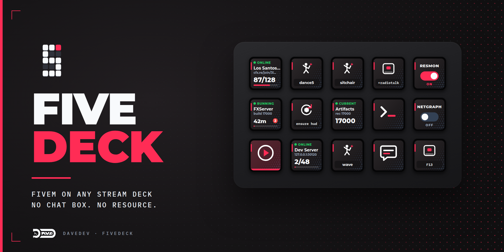

# FiveDeck for Stream Deck



[](https://www.microsoft.com/windows)
[](https://www.elgato.com/us/en/s/stream-deck)
[](LICENSE)

FiveDeck connects any Elgato Stream Deck to FiveM. It runs commands and emotes
over a direct local connection without opening chat or F8, joins servers by
join code with live player counts, and starts, restarts, and watches a local FXServer while you develop. FiveDeck is a
standalone Stream Deck plugin: servers don't need to install a resource, and
players don't need to install anything in FiveM.

> **Direct-connection preview.** This version includes automated transport tests,
> but still needs Windows in-game validation, including FiveM Enhanced. A
> successful connection test does not prove that a particular command executed.
> Command support varies by client version and server permissions. Please
> [report anything that doesn't work](https://github.com/Soldrynn/DaveDev-Streamdeck-Plugins/issues/new/choose).

## Features

FiveDeck provides the following actions.

For players:

| Action | Press | Shows |
| --- | --- | --- |
| Game Command | Runs one or more console commands. In Hold mode, `+commands` run on press and `-commands` on release. In Toggle mode, it alternates between two sets. | The command icon, lit for the last requested toggle state |
| Emote | Plays an emote; hold the key to cancel it | The emote name |
| Chat Message | Types a message or chat command into chat | Static icon |
| Game Key | Presses or holds a key, such as F13–F24, in the game | The key name |
| Join Server | Tap to join; hold to switch servers now | Server name, players, and capacity |
| Launch FiveM | Tap to start or focus FiveM; hold to quit | Whether FiveM is running |

For developers:

| Action | Press | Shows |
| --- | --- | --- |
| Dev Toggle | Turns resmon, netgraph, FPS, perf, streaming debug, or net event log on or off | The last requested on/off state, not verified game state |
| FXServer | Tap to start (or open the live log); hold to stop | Status, uptime, players, and a script-error count |
| Server Command | Runs `ensure`, `restart`, `stop`, or `refresh` for a resource, or any console commands | The resource name |
| Artifact Watch | Tap to download the recommended build; hold for the latest | Your build compared with the recommended and critical builds |

For Stream Deck +:

| Action | Rotate | Press or touch |
| --- | --- | --- |
| Command Dial | Choose from a list of commands, or pick a number | Runs the choice, for example `e dance` or `setradio 4` |

## Requirements

To use FiveDeck, you need the following:

- Windows 10 or 11 on an x64 computer.
- Elgato Stream Deck 7.1 or later, and any Stream Deck with keys. Command
  Dial needs a Stream Deck +.
- FiveM for the player actions. FXServer, Server Command, and Artifact Watch
  work without FiveM installed.

## Install FiveDeck

To install FiveDeck, do the following:

1. Export a backup of your Stream Deck profile, then use the supplied
   `FiveDeck-0.2.0.1-direct-preview.streamDeckPlugin` test installer. This preview
   is not a public stable release; it updates the existing FiveDeck plugin.
2. Double-click the downloaded file, and then approve the installation in
   Stream Deck.
3. In the Stream Deck action list, expand the **FiveDeck Preview** category.
4. Drag an action such as **Emote** or **Join Server** onto a key.

## Set up direct commands

Game Command, Emote, Dev Toggle, and Command Dial send commands to FiveM's
local Remote Console connection. Join Server's switch action and Launch
FiveM's quit action also use this connection. No FiveM resource, bridge bind,
or command-file installation is needed. Command actions never fall back to
opening F8, typing into chat, or sending a hidden keyboard shortcut.

1. Start FiveM normally.
2. Open a command action's settings in Stream Deck. Under **Connection settings
   & setup**, choose the **Client**. This setting applies to all command keys
   and dials:
   - **Primary:** `127.0.0.1:29200`.
   - **Legacy secondary (-cl2):** `127.0.0.1:29300`, for the secondary Legacy
     client started with `-cl2`. Enhanced supports only the primary port 29200.
3. **FiveM Legacy:** use its normal loopback listener. Do not add `-devcon`;
   on Legacy that option widens the listener's network binding beyond this PC.
   **FiveM Enhanced:** Remote Console is disabled by default. Open **F8 →
   Console → Remote Console** and enable it once, then close F8. FiveDeck does
   not change this setting for you. Enhanced compatibility still needs
   in-game validation in this preview.
4. Click **Test connection**. It performs the Remote Console handshake without
   running a command. The result should say **FiveM responded**.
5. Return to the game and press your Stream Deck command key, or press/touch
   the Command Dial. Each intentional press opens its own connection, sends
   the command batch, and closes the connection.

### First safe in-game test

For the complete prioritized Windows checklist, including backup, recovery, focus,
and session tests, see [Windows testing](docs/WINDOWS-TESTING.md).

Add **Game Command**, select **Press**, and enter `echo FIVEDECK_TEST`. Run
**Test connection**, return to FiveM, and press the Stream Deck key once.
The key briefly shows **SENDING**, then **SENT**. Neither F8 nor chat should
open. `echo` changes no game state; if you want to confirm processing, open F8
manually afterward and look for `FIVEDECK_TEST`, then close it. That manual
inspection is only for this diagnostic. Next test a harmless command known
to exist on your server, such as your configured emote command.

**CHECK LINK** means dispatch failed; inspect the connection panel. **CHECK
GAME** means transmission began but its result is uncertain. Check the game
before repeating a command. **SENT** confirms local transmission only.

### Understand connection feedback

The connection panel is visible without opening advanced settings, including
on Command Dial. It shows the **last connection result**, not a continuously
monitored socket. **FiveM responded** means the handshake succeeded at that
point. **Command transmitted** means the command was sent; it does not confirm
that FiveM accepted or executed it. The panel reports the last transmission
time seen by that inspector and labels execution as unconfirmed.

A connection failure produces a warning instead of keyboard input. FiveDeck
never automatically reconnects or retries a command. After fixing the cause,
use **Test connection** and make a new deliberate press when ready. A command
may already have executed even if the connection failed afterward, so check
the game before repeating an action with side effects.

Connection success does not establish that a particular command is allowed. A
command must exist and be allowed by your FiveM build and server. A chat-only
command may require the explicit **Chat Message** action instead.

### Command batches and holds

Enter one command per line; a leading `/` is optional. Each press sends one
batch, limited to **1024 UTF-8 bytes** in this preview. FiveM interprets
`wait 1000` and other command-buffer syntax; **Command transmitted** does not
wait for those commands or delays to finish. In Hold mode, `+commands` run on
press and matching `-commands` are sent on release. A lost connection can
prevent the release from reaching the game; use the game's own control to
release it if needed. FiveDeck cancels releases when the selected client,
game process or connection generation changes, rather than replaying them
into another session. Prefer Game Key for critical push-to-talk controls.

### Existing profiles

Existing command-action keys using the old **Bridge**, **F8 console**, or
**Chat** transport automatically use the direct connection. There is no
per-key transport selector or bridge auto-install step anymore. The explicit
**Chat Message** action is unchanged and still types into chat. **Game Key**
still sends the key you choose. Old bridge binds are no longer used by command
actions; FiveDeck does not need to install or rewrite them.

### Keyboard input stays explicit

**Chat Message** and **Game Key** still send keyboard input. They only send
keys while a FiveM or RedM window is in the foreground. To bring FiveM to the
front first, enable **Bring FiveM to the front before sending keys** in their
**Keyboard input** settings. Chat key, typing delay, and scan-code settings
apply to these input actions, not to direct commands.

## Use the player actions

### Push-to-talk and other hold controls

To make a Stream Deck key work like a held key, do one of the following:

- **Bind a FiveM control to the Stream Deck key.** Add **Game Key** with F13
  and **Mirror the Stream Deck key (hold)**. In FiveM, open **Settings → Key
  Bindings → FiveM**, select a control such as radio push-to-talk, and press
  the Stream Deck key. FiveM records F13 and treats the key like any other.
- **Run the command directly.** Add **Game Command** in **Hold** mode with a
  `+command` such as `+radiotalk`. FiveDeck runs `+radiotalk` on press and
  `-radiotalk` on release.

### Join and switch servers

Join Server supports the **primary client only**. Select Primary before using
it. Legacy secondary remains available for ordinary command keys and dials.

**Join Server** accepts a join code (`abc123`), a `cfx.re/join` link, a
server-list link, a `fivem://connect` link, a pasted `connect` command, or an
address such as `127.0.0.1:30120`.

When you tap the key, FiveDeck starts FiveM with a `fivem://connect` link if the
game is closed. If FiveM is already open, FiveDeck hands the link to it, the
same way a browser's **Connect** button does.

FiveM doesn't reject a link it receives while you're in a server. It holds the
link until the session ends, which is why join links often seem blocked. To
switch servers in one press, **hold** the Join Server key: FiveDeck sends the
link and then sends `disconnect` through the direct connection. This requires
a working Remote Console connection; FiveM handles the pending link as it
leaves the old server.

The key shows the server's name, player count, and capacity. For addresses,
FiveDeck reads the server's own `/dynamic.json` and `/info.json`. For join
codes, it uses the Cfx server list and refreshes at most once a minute. If the
list can't be reached, the key shows **JOIN** instead of a player count.

## Use the developer actions

### FXServer

FXServer starts a local server from `FXServer.exe`, either with a
`server.cfg` or as txAdmin. The server runs from the folder that holds
`server.cfg`, just like `FXServer.exe +exec server.cfg`.

The server can run in one of two console modes:

- **Hidden** (default): FiveDeck owns the console. You get a live log window,
  graceful stops with `quit`, commands from Server Command without RCON, a
  count of script errors, and the txAdmin PIN on the key during first-time
  setup. A hidden server stops when Stream Deck closes.
- **Own window:** FXServer opens its usual console window for you to type into.
  It keeps running after Stream Deck closes, and stopping it from Stream Deck
  ends the process.

Tap the key to start the server. While it runs, a tap opens the live log,
restarts the server, or opens txAdmin, depending on the key's setting. Hold
the key to stop the server. The key's status is `STARTING` until the server
answers on its game port, and then `RUNNING`.

### Server Command

Server Command restarts a resource or runs console commands on a server. If
FiveDeck started that server hidden, commands go straight into its console.
Otherwise, FiveDeck uses RCON. To use RCON, do the following:

1. Add `set rcon_password "a-long-unique-password"` to `server.cfg`. The
   password can't contain spaces.
2. In the key settings, select a server and enter its host, game port, and
   RCON password.

The key flashes a warning if FXServer replies `Couldn't find resource` or
prints a script error.

RCON is unencrypted, so use it only on the same computer or a trusted LAN.
FXServer limits RCON from other networks to one request every five seconds.
FiveDeck saves server connections in its global settings, so exported Stream
Deck profiles never contain RCON passwords.

### Server slots

FXServer, Server Command, and Artifact Watch share three server slots. Give a
slot a name, host, and game port once, and every key that uses that slot
follows it. For example, point an FXServer key and several Server Command keys
at **Server 1** to restart resources on the server that key started.

### Artifact Watch

Artifact Watch reads the same version feed that txAdmin uses. It compares the
feed with the build your server reports in `/info.json`, and shows
`CRITICAL`, `OUTDATED`, `CURRENT`, or `AHEAD`.

## Troubleshoot FiveDeck

### A command key flashes a warning and nothing happens

- Open that action's settings and read the connection panel above the advanced
  settings. Confirm that FiveM is running and **Client** selects the intended
  primary or Legacy secondary instance.
- On Enhanced, enable **F8 → Console → Remote Console** once. Enhanced uses
  port 29200 only. On Legacy, do not add `-devcon` to fix a connection failure.
- Click **Test connection**. If FiveM responds but the command has no effect,
  check the command name, client version, and server permissions. A successful
  handshake or transmission is not execution confirmation.
- For **Chat Message** or **Game Key**, keep FiveM active or enable **Bring
  FiveM to the front before sending keys**. FiveM key bindings can be blocked
  in menus and text boxes.

The plugin log in `%APPDATA%\Elgato\StreamDeck\Plugins\com.davedev.fivedeck.sdPlugin\logs`
records connection and command failures. FiveDeck does not retry failed
commands or switch to typing; check the game before deliberately pressing
again.

### A developer overlay is out of step

The Dev Toggle key tracks FiveDeck's last requested state and alternates the
next command it sends. It cannot verify an overlay's actual state. FiveM may
remember overlays between sessions, and a command may be rejected by the
client or server. Check the overlay in the game; if the connection works and
the command is allowed, press again to request the opposite state.

### Typed text is wrong on my keyboard layout

FiveDeck types text as Unicode characters, so typed text doesn't depend on the
keyboard layout. This applies to **Chat Message**. Chat-opening keys and
**Game Key** use a virtual key plus its scan code. If one does not respond,
turn on **Send scan codes only**, or raise **Input delay** for chat on slower
computers. These settings do not affect direct commands.

## Known limitations

- FiveDeck supports Windows only, because FiveM and its input run on Windows.
- The direct protocol has automated tests but still needs Windows in-game
  validation, including Enhanced. No command execution acknowledgement is
  available; connection and transmission results are the only confirmations.
- The client command receiver does not reassemble fragmented command packets.
  FiveDeck uses one bounded write per fresh connection to reduce this risk,
  but TCP can still split a write. Transmission does not prove full receipt
  or execution.
- The direct connection is local-only. FiveDeck does not enable Remote Console,
  widen its binding, or change firewall settings.
- Commands and developer overlays remain subject to the client build,
  command availability, and server permissions.
- Game Key bindings may not run in menus or while a text field has focus,
  which is FiveM's own rule.
- FiveM key bindings can't use modifier keys, so use F13–F24 without
  modifiers for **Game Key** controls that you bind in FiveM.
- Join-code status depends on the public Cfx server list, which can rate-limit
  or block automated requests.
- `players.json` hides player names on current FXServer builds, so FiveDeck
  shows counts, not names.

## Security and privacy

FiveDeck doesn't collect telemetry. Direct client commands connect only to
`127.0.0.1` on the selected port. Keep the Remote Console listener local;
FiveDeck does not add authentication to it or change your network settings.
Explicit keyboard actions send keys only to FiveM windows. FiveDeck starts
FXServer and FiveM directly instead of through a command shell and keeps RCON
passwords out of shareable profiles. See the repository's
[security policy](../../SECURITY.md) to report a vulnerability.

## Build from source

You need Node.js 24 or later. Build on Windows, or on any system with network
access, where the build downloads the Windows koffi module and checks it
against the lockfile's integrity hash. From `plugins/fivedeck`, run:

```powershell
npm ci
npm run build
npm run check
npm run validate
npm run pack
```

The installer is written to `dist\com.davedev.fivedeck.streamDeckPlugin`.

To regenerate the artwork, run `npm run assets`, which writes the icons and
key images, and `npm run ui`, which writes the property inspectors.
`branding/README-assets.txt` covers the Marketplace images.

## Project layout

FiveDeck lives in `plugins/fivedeck`:

| Path | Purpose |
| --- | --- |
| `branding/` | App icon source, Marketplace thumbnail and gallery, and their render scripts. |
| `com.davedev.fivedeck.sdPlugin/` | Manifest, generated property inspectors, layouts, and assets. |
| `scripts/` | Build, asset and UI generators, validation, and the bundle smoke test. |
| `src/core/` | FiveM direct transport, Windows input, FXServer supervision, RCON, server queries, and key art. |
| `src/actions/` | Stream Deck actions. |
| `tests/` | Behaviour tests that run without Stream Deck or FiveM. |

## License

FiveDeck is licensed under the [Apache License 2.0](LICENSE). Bundled
third-party components remain under their own licences; see the
[third-party notices](THIRD_PARTY_NOTICES.md).

FiveM, RedM, FXServer, txAdmin, and Cfx.re belong to their respective owners.
Stream Deck and Elgato are trademarks of Corsair Memory, Inc. FiveDeck is an
independent project and is not affiliated with or endorsed by Cfx.re, Rockstar
Games, Take-Two Interactive, or Elgato.
